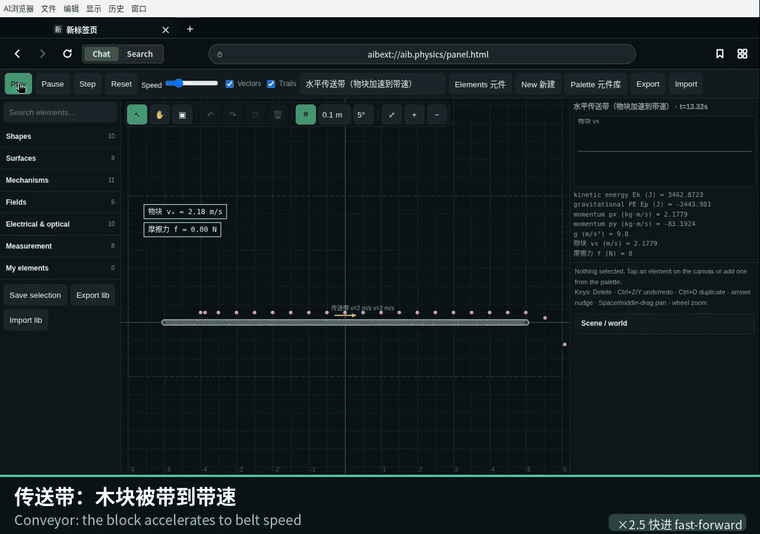
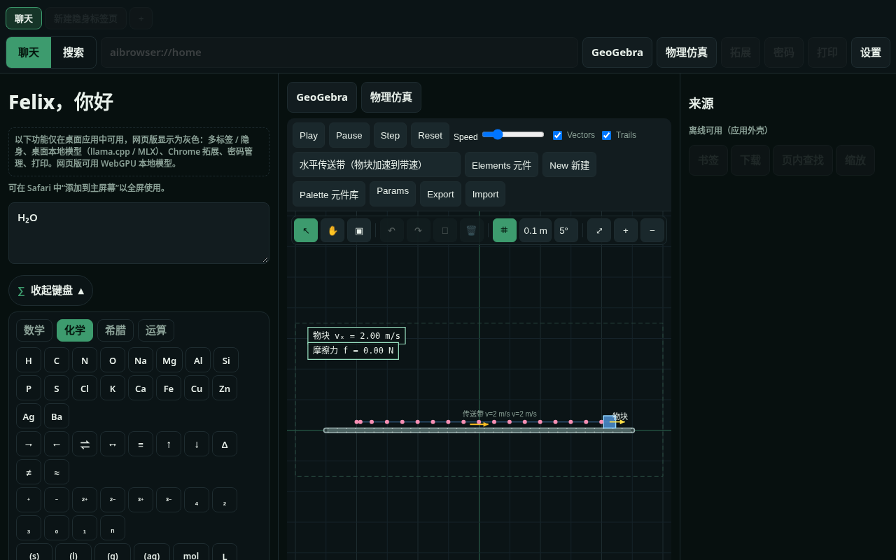
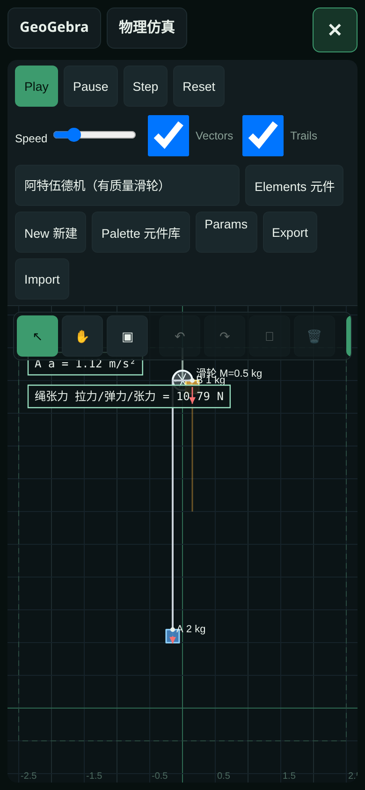
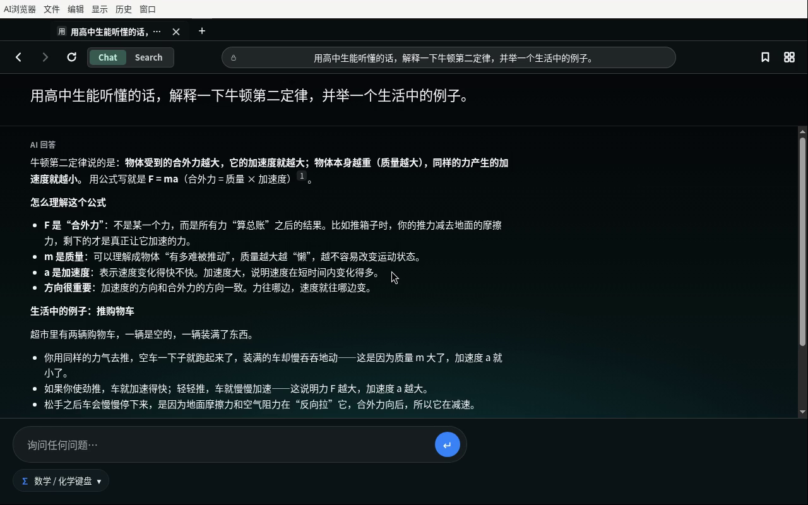

[**English**](README.md) | [中文](README_zh.md)

# AI Browser

[](https://felixshine2009-cmd.github.io/ai-browser/)
[](https://github.com/felixshine2009-cmd/ai-browser/releases/latest/download/AI-Browser-mac-arm64.zip)

### 👉 [**Try the web app / 在线使用网页版**](https://felixshine2009-cmd.github.io/ai-browser/) · [**Download for Mac (Apple Silicon)**](https://github.com/felixshine2009-cmd/ai-browser/releases/latest/download/AI-Browser-mac-arm64.zip)

[](https://github.com/felixshine2009-cmd/ai-browser/releases/latest)
[](https://github.com/felixshine2009-cmd/ai-browser/releases/latest)
[](package.json)
[](https://felixshine2009-cmd.github.io/ai-browser/)

**A Chinese-first AI browser for Apple Silicon Macs — chat, agent tools, local models, GeoGebra and a physics lab in one Chromium app.** Desktop release is Mac-only for now (no Windows build yet); the web/PWA version runs anywhere.



| Web version (desktop) | Web version (mobile) | Desktop app |
|---|---|---|
|  |  |  |

<sub>Screenshots are captured from the real web version and the real desktop app. More: [web home + chem keyboard](docs/images/web-home.png), [GeoGebra](docs/images/web-geogebra.png), [self-modifying code diff](docs/images/desktop-selfmod.png).</sub>

## Features

**AI & agent**
* AI agent that drives the browser through a single tool registry: tabs, search, page reading, settings, knowledge base, models, GeoGebra, physics, code patches…
* Agentic web search with `[n]` citations; chat with your own cloud API key (OpenAI / Anthropic format, presets) or with local models. In chat, web search is the default unless you ask for a tool such as a graph
* Answer style (concise or detailed — both stay structured), thinking levels, and a live status line. Tool names stay above the answer
* Chat titles and a chat history kept apart from browsing history. Follow-ups, especially problem solving, keep the earlier turns
* Sensitive actions (clearing history, deleting models) always ask for confirmation; passwords are never exposed to the AI

**Python & Linux VM**
* Built-in Python 3 for calculations and programming: the AI runs code for non-trivial math, statistics, simulations and data work, then verifies the result. numpy, scipy, sympy, mpmath, pandas and matplotlib are preinstalled; figures appear in the answer
* Code, output and running state are shown in a collapsible panel above the answer, with a Stop button; each conversation keeps its own Python session
* More libraries install from PyPI on request or under Settings → Python & VM (view, install, uninstall; optional mirror)
* Desktop: a Linux virtual machine (Apple Virtualization framework) the AI can work in like a bot — shell commands with live output, file read/write, upload and download, internet access, a shared folder and a persistent disk. Start, stop, reset, memory and CPU settings are in Settings. Python runs inside the VM when it is running, otherwise with the bundled interpreter
* Web: Python runs in the browser with Pyodide and keeps working offline after the first download. iPad: an embedded Alpine Linux VM runs Python and shell commands on the device, and saves installed libraries and files between launches

**Local models**
* MLX and llama.cpp on desktop, including an MTP-capable MLX LM path, plus WebGPU in the web version; auto-detects LM Studio, Ollama, oMLX and other OpenAI-compatible servers
* Resumable downloads (pause / resume, mirror fallback, sha256 check), Hugging Face search, per-model disk usage with separate cache / file cleaning

**Language**
* Hunyuan HY-MT translation, sentence analysis, dictionary lookup (MDX/MDD). In search mode the Siri sidebar summarizes the page, shows a side-by-side translation, and answers questions about it. A selected word offers the dictionary; a selected sentence offers translation
* Local knowledge base with semantic search (EmbeddingGemma)
* Offline encyclopedia in the ZIM format used by Kiwix: open a `.zim` file to search titles and read full article pages (with images, styles, and internal links). The file is copied into the app directory, as dictionaries are. JSONL import remains available. See [docs/OFFLINE_WIKI.md](docs/OFFLINE_WIKI.md)

**Browser**
* Tabs, incognito tabs with their own in-memory session, built-in password manager, Chrome Web Store extensions, print / save as PDF
* Multithreaded downloads that also start a normal download, and fall back to that normal download when the server has no Range support
* In-app check for a newer Chromium / Electron kernel
* First-run onboarding wizard
* Frosted-glass chrome, a collapsible tool tray (GeoGebra, physics, problem solving, and the rest), and icon shortcuts under the home box
* Color themes (each swatch shows the whole palette), plus a custom home background and layout
* Feature extensions can change layout and browser settings. Task mode lets the assistant drive the browser toward a goal you type

**Math**
* Full GeoGebra (graphing, geometry, 3D, CAS, scientific) with its math keyboard
* **Math / chemistry virtual keyboard** on the home page and in chat (Math, Chem, Greek and Ops tabs)
* Problem solving: type or paste a question, attach a picture, add reference notes, or scan a QR code and take the photo on your phone
* High-school calculation helpers the assistant can call (algebra, sequences, mechanics, circuits, gases, pH, and similar)

**Physics**
* Physics engine with 34 examples; every high-school parameter is editable
* **Element library**: 54 elements (conveyors, pulleys, rails + rod, E/B fields, optics, measurement tools), live inspector with undo/redo, and 「我的元件」 custom elements with JSON import/export

**Self-modifying code**
* The AI can propose patches to the app in a sandbox: diff preview → your approval → one-click rollback; the app bundle is never overwritten

The **web version (PWA)** at https://felixshine2009-cmd.github.io/ai-browser/ works with your own API key or WebGPU local models, and includes Python (Pyodide); desktop-only features are grayed out. Add it to the Home Screen on iPhone Safari. The desktop app targets **Apple Silicon (M1/M2/M3) macOS 12+**.

## iPad

An unsigned iPad build is available as `AI-Browser-iPad-unsigned.ipa`. It wraps the same web app with Capacitor (MIT), supports iPad (and iPhone) with all orientations, and uses the same interface: desktop-only features stay grayed out with “Desktop only”. You can open a ZIM encyclopedia (stored in the app directory when the system allows, otherwise kept in memory for the session), pick files, and use the camera or photo library when solving a problem. Local WebGPU models degrade gracefully if the device does not support WebGPU. The IPA embeds a Linux virtual machine (Alpine Linux in the v86 emulator) with Python, numpy, scipy, sympy, pandas and matplotlib; the AI can run Python and shell commands in it offline. The VM has no internet access: extra pure-Python libraries are downloaded by the app and installed into the VM, and libraries with native code are installed into Pyodide.

The IPA is **unsigned**. Install it by sideloading with a tool such as AltStore or Sideloadly and your own Apple ID. Free Apple Developer accounts must re-sign the app every 7 days.

See the [iPad release](https://github.com/felixshine2009-cmd/ai-browser/releases/tag/ipad-v1.1.0).

## Install (recommended)

| File | Description |
|---|---|
| `AI-Browser-mac-arm64.zip` | Unsigned `AI Browser.app` (macOS arm64) — includes EmbeddingGemma (knowledge base); the HY-MT translation model downloads on first use |
| `install.command` / `install.sh` | Unzip → copy to `/Applications` → `xattr -cr` → launch |
| `AI-Browser-source.zip` | Source (no `node_modules`, no model files) |
| `README.md` / `README-zh.md` | English / Chinese README |

**macOS:**

1. Put `AI-Browser-mac-arm64.zip` and `install.command` in the same folder.
2. Double-click `install.command` (or run `bash install.sh`).
3. If macOS says the developer cannot be verified: System Settings → Privacy & Security → Open Anyway, or run `xattr -cr "/Applications/AI Browser.app" && open "/Applications/AI Browser.app"`.

**Windows:** no Windows build yet.

## First run

1. **Settings → General**: display name, greeting, 中文 / English.
2. **Settings → AI Model**: *Custom API* (pick a provider such as OpenAI, DeepSeek, Qwen, Gemini, Groq, Mistral, or a custom endpoint; **Test connection** shows a specific reason if it fails), *Local model* (built-in catalog, Hugging Face search, engine and download source, model roles) or *Local frameworks* (LM Studio, Ollama, oMLX …).
3. **Search engine**: Bing / Google / Baidu / DuckDuckGo / custom `%s`; the agent uses the selected engine.
4. **Dictionaries**, **Knowledge base**, **Extensions**, **History**, **Passwords** and **Privacy** are sections in the same Settings page (`aibrowser://settings#passwords` …).

Without a configured model, asking gives a friendly error — the app does not crash.

## Chat mode

| Input | Behaviour |
|---|---|
| Single word | Dictionary extension (MDX) first; otherwise an AI-generated entry marked “AI generated” |
| Sentence | Translation (HY-MT) + subject / predicate / object colouring and structure breakdown |
| Long text | Translation only, source / translation columns |
| Question | **Agentic search** with `[n]` citations, or any other registered tool (knowledge base, browser actions …) |

## Models and licences

* Built-in catalog (GGUF for llama.cpp, plus `mlx-community` MLX variants): **Qwen3**, **Qwen2.5**, **Gemma 4** (E2B / E4B / 12B / 26B-A4B / 31B, Apache-2.0), **Gemma 3n**, **Gemma 3**, **Hunyuan-MT**, Seed-X, **EmbeddingGemma**. Size and estimated RAM are shown for every entry.
* **Gemma 3 / 3n / EmbeddingGemma** are covered by the [Gemma Terms of Use](https://ai.google.dev/gemma/terms) and prohibited-use policy; **Gemma 4** is Apache-2.0. The bundled EmbeddingGemma file is distributed under the Gemma terms.
* **HY-MT1.5** is under the Tencent Hunyuan Community License (**not licensed in the EU, UK and South Korea**); check it before redistributing.
* Qwen models are Apache-2.0 (Qwen3, most Qwen2.5 sizes — see each model card).

## Extensions

* **Feature extensions** (`aib-feature/1`, see [`docs/EXTENSION_STANDARD.md`](docs/EXTENSION_STANDARD.md)): Dictionary, GeoGebra and Physics are pre-installed; extensions can declare agent tools in `manifest.contributes.tools`.
* **Chrome extensions** (MV3): installed from the Chrome Web Store inside the browser. Coverage is limited by Electron's extension API support (content scripts, service workers and `chrome.storage` are tested; toolbar popups are limited).
* GeoGebra is bundled for **non-commercial** use under the [GeoGebra license](https://www.geogebra.org/license).

## From source

```bash
unzip AI-Browser-source.zip && cd ai-browser
npm ci
npm start
npm run dist:mac   # build the darwin-arm64 app (dist/); drop the two .gguf files in ./models first to bundle them
```

## Known limitations

1. **Needs verification on a real Mac:** Metal inference with node-llama-cpp (Gemma 4 GGUF loading is untested), the MLX engine (tested only against a mock `mlx_lm.server`), Touch ID prompts, the native print dialog.
2. The app is unsigned / not notarised.
3. Chrome-extension API coverage is limited by Electron.
4. Search engines may show captchas to scripted requests; the fallback chain and relevance filter mitigate this.
5. `mlx-lm` is not bundled (`pip3 install mlx-lm`), or use oMLX through *Local frameworks*.

## Credits

* Physics element library: own engine and own canvas drawings. Algorithmic lineage: **Box2D-lite** by Erin Catto (MIT). No third-party code, icons or SVGs are bundled; no GPL code is used. Full list and licence text: [THIRD_PARTY_NOTICES.md](THIRD_PARTY_NOTICES.md).

## License

MIT. Author: Felix.
