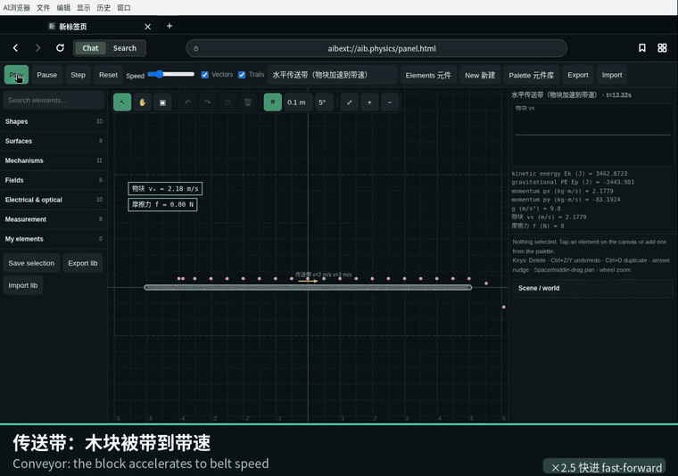
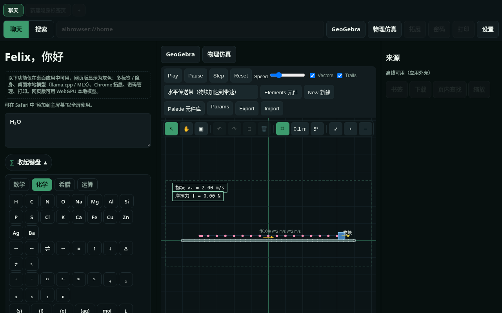
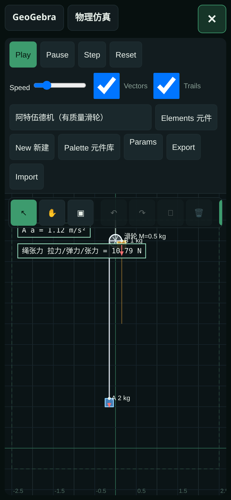
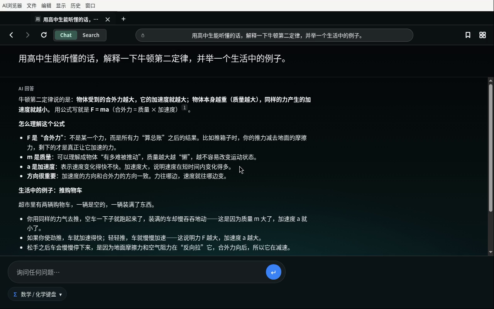

[English](README.md) | [**中文**](README_zh.md)

# AI 浏览器

[](https://felixshine2009-cmd.github.io/ai-browser/)
[](https://github.com/felixshine2009-cmd/ai-browser/releases/latest/download/AI-Browser-mac-arm64.zip)

### 👉 [**在线使用网页版 / Try the web app**](https://felixshine2009-cmd.github.io/ai-browser/) · [**下载 Mac 版（Apple 芯片）**](https://github.com/felixshine2009-cmd/ai-browser/releases/latest/download/AI-Browser-mac-arm64.zip)

[](https://github.com/felixshine2009-cmd/ai-browser/releases/latest)
[](https://github.com/felixshine2009-cmd/ai-browser/releases/latest)
[](package.json)
[](https://felixshine2009-cmd.github.io/ai-browser/)

**面向 Apple 芯片 Mac 的中文优先 AI 浏览器 —— 聊天、Agent 工具、本地模型、GeoGebra 和物理实验室，一个 Chromium 应用全包。** 桌面版暂时只有 Mac（暂无 Windows 版）；网页版 / PWA 可在任何设备使用。



| 网页版（桌面） | 网页版（手机） | 桌面应用 |
|---|---|---|
|  |  |  |

<sub>截图均来自真实的网页版与桌面应用。更多：[网页版主页 + 化学键盘](docs/images/web-home.png)、[GeoGebra](docs/images/web-geogebra.png)、[AI 自修改代码 diff](docs/images/desktop-selfmod.png)。</sub>

## 功能

**AI 与 Agent**
* AI Agent 通过统一工具注册表操作浏览器：标签页、搜索、读网页、设置、知识库、模型、GeoGebra、物理、代码补丁等
* 带 `[n]` 引用的智能搜索；可用你自己的云端 API Key（OpenAI / Anthropic 格式，带预设）或本地模型聊天。聊天时若没有画图之类的专门请求，默认先做网页搜索
* 各模型服务商的模型列表：保存 API Key 时自动从服务商官方接口获取可用模型，也可点击“刷新”手动获取；无法获取时显示带明确标注的内置推荐列表。支持手动添加、移除模型 ID，并可勾选启用的模型（支持搜索、全选 / 全不选，以及视觉、思考、上下文长度提示）；只有已启用的模型会出现在模型切换器中
* 主页、聊天、解题输入框旁及网页版均提供快速模型切换器：按服务商分组、可搜索、支持键盘操作；在聊天中可仅对当前对话生效
* 可调回答风格（简洁或详细，两种都保持清楚的结构）、思考等级，以及发送后的实时状态。用过哪些工具只显示在回答上方
* 聊天标题由 AI 生成，聊天记录与浏览历史分开保存。追问（尤其是解题）会接着上文
* 对话以会话形式延续：追问显示在上一条回答下方，重启后仍保留；对话列表可搜索，可重新打开、重命名或删除。模型的思考过程在生成时以折叠方式显示。发送按钮在回答过程中变为停止按钮（Esc / ⌘.），可终止回答、正在运行的工具与 Agent 步骤，并保留已生成的部分
* 结构化回答：标题、表格、引用与 LaTeX 公式；化学方程式自动排版并检查原子与电荷是否守恒；函数可直接从回答中在 GeoGebra 中作图；单词卡片可打开词典释义
* 文档：排版引擎支持固定页面尺寸、流式与绝对定位元素、旋转、自动分页与重叠检查。各类助手可生成文章、讲义、幻灯片、表格与图表、试卷与错题本、单词卡片及思维导图；每份文档以卡片形式显示预览，并可导出 PDF / HTML
* 清除历史、删除模型等敏感操作一律先确认；密码永远不会暴露给 AI

**Python 与虚拟机**
* 内置 Python 3，用于计算与编程：遇到较复杂的数学、统计、模拟或数据处理时，AI 会编写并运行代码，并对结果进行验证。预装 numpy、scipy、sympy、mpmath、pandas、matplotlib，绘制的图像直接显示在回答中
* 代码、输出与运行状态显示在回答上方的可折叠面板中，并提供“停止”按钮；每个对话拥有独立的 Python 会话
* 其他库可按需从 PyPI 安装，也可在“设置 → Python 与虚拟机”中查看、安装和卸载（可选镜像源）
* 桌面版：内置 Linux 虚拟机（Apple Virtualization 框架），AI 可以像 Bot 一样在其中工作——执行命令并实时输出、读写文件、上传与下载、访问互联网，并提供共享文件夹与持久磁盘。可在设置中启动、关闭、重置虚拟机并调整内存与 CPU。虚拟机运行时 Python 在虚拟机内执行，否则使用内置解释器
* 网页版：通过 Pyodide 在浏览器内运行 Python，首次下载后可离线使用。iPad：内嵌 Alpine Linux 虚拟机，在设备上运行 Python 与命令，并在启动之间保存已安装的库和文件

**本地模型**
* 桌面版 MLX / llama.cpp（含可启用 MTP 的 MLX LM），网页版 WebGPU；自动探测 LM Studio、Ollama、oMLX 及其他 OpenAI 兼容服务
* 多连接分段下载（各分段均可续传，并检测停滞），Hugging Face 与魔搭（ModelScope）两种下载源按速度排序并自动切换，支持暂停 / 继续与 sha256 校验；Hugging Face 搜索、按模型显示磁盘占用并分别清理缓存 / 文件

**语言**
* 混元 HY-MT 翻译、长难句分析、词典查询（MDX/MDD）。搜索模式下右侧 Siri 侧栏可以摘要当前页、对照翻译，并针对这一页提问。选中单词弹出词典，选中句子弹出翻译
* 本地知识库（EmbeddingGemma 语义检索）
* 离线百科采用与 Kiwix 应用相同的 ZIM 格式：打开 `.zim` 文件后即可检索词条并阅读完整页面（含图片、样式与内部链接）。文件会像词典一样复制到应用程序目录。仍可导入 JSONL。详见 [docs/OFFLINE_WIKI.md](docs/OFFLINE_WIKI.md)

**浏览器**
* 标签页、独立内存会话的隐身标签页、内置密码管理器、Chrome 应用商店拓展、打印 / 另存为 PDF
* 多线程下载会同时开始普通下载；服务器不支持分段时自动停掉多线程，只留下普通下载
* 可在浏览器里检查 Chromium / Electron 内核是否有新版本
* 首次启动设置向导
* 磨砂玻璃界面，右上角可收起的工具栏（GeoGebra、物理、解题等），主页输入框下是不带文字的工具图标
* 多套配色（每一套都会列出其中的全部颜色），主页背景和布局可以自己定
* 功能拓展可以改布局和浏览器设置。Task 模式里，助手按你写的目标去操作浏览器，可使用全部浏览器工具（标签页、工具视图、分屏、空间、稍后阅读、页面助手、截图、外观等），每一步都以工具卡片显示

**数学**
* 完整 GeoGebra（绘图、几何、3D、CAS、科学计算器）及数学键盘
* **数学 / 化学虚拟键盘**：主页与聊天中可用（数学、化学、希腊字母、运算符号分页）
* 解题：输入或粘贴题目、上传图片、添加参考资料，或扫描二维码拍照上传
* 面向高中范围的计算工具，助手在代数、数列、力学、电路、气体、pH 等问题里可以直接调用

**物理**
* 物理引擎：34 个示例，所有高中物理参数可改
* **元件库**：54 个元件（传送带、滑轮、轨道 + 导体棒、电磁场、光学、测量工具）、带撤销/重做的实时检查器，以及「我的元件」自定义元件（JSON 导入/导出）

**AI 自修改代码**
* AI 可在沙箱中为应用提出补丁：diff 预览 → 你批准 → 一键回滚；永不覆盖安装包

**网页版（PWA）**：https://felixshine2009-cmd.github.io/ai-browser/ ——用你自己的 API Key 或 WebGPU 本地模型，并支持 Python（Pyodide）；仅桌面功能显示为灰色。iPhone Safari 可「添加到主屏幕」。桌面版面向 **Apple 芯片（M1/M2/M3）macOS 12+**。

## iPad

iPad 版由桌面版直接移植：原生宿主运行与桌面版相同的主程序与页面，界面与功能与桌面版一致。以未签名的 `AI-Browser-iPad-unsigned.ipa` 发布（需 iPadOS 16 或更高版本）。

* **工具独立视图**：解题、拍题、GeoGebra、物理实验、离线百科（ZIM）、词典（MDX）、代码编辑器与稍后阅读直接显示在地址栏下方，不再作为网页标签打开。每个工具主页均可将输入交给 AI、切换模型并调节思考等级，协作侧栏可以收起。
* **相机**：拍题即解（Apple Vision 文字识别，支持图像的模型负责转写公式）；凡可添加图片之处均可直接拍照；使用系统相机扫描二维码。
* **公式渲染**：AI 回答中的数学公式与化学方程式由离线 KaTeX 排版。
* **分屏与空间**：两个标签页并排显示，分隔线可拖动调整；标签页可按学科归入不同空间。
* **页面助手**：一键摘要网页与 PDF；回答问题时附带编号引用，点击即可定位原文段落。
* **稍后阅读**：保存网页的完整离线副本，并可与离线百科一并检索。
* **代码编辑器**：管理“我的代码”、Python 工作目录与 Linux 虚拟机共享目录中的文件，支持语法高亮，一键运行 Python、Shell 与 HTML 文件。
* **Python 与 Linux**：内置 Python（Pyodide）与 Alpine Linux 虚拟机（v86），AI 可离线使用；可导入并启动自定义的 ISO、IMG、QCOW2 系统镜像。Linux 镜像（约 121 MB）在首次使用虚拟机时下载，因此安装包本身保持精简。
* **从“文件”导入**：词典既可以逐个文件添加，也可以导入整个文件夹（一次导入多部词典及其 .mdd 资源、样式与字体）；尚未从 iCloud 云盘下载的项目会在导入时自动下载，并显示进度。
* **Liquid Glass**：在 iPadOS 26 上，工具栏与工具面板采用系统 Liquid Glass 材质，图标以原生方式绘制；较早的 iPadOS 版本显示磨砂玻璃效果。
* **文档**：与桌面版相同的排版引擎与生成助手；导出 PDF 时每个文档页面对应一页。
* **本地模型**：llama.cpp，使用 Metal 加速。
* **稳定性**：长时间使用、应用挂起或网页内容进程重启后，页面与主程序之间的连接自动恢复。

IPA **未签名**，请使用 AltStore、Sideloadly 等工具以您自己的 Apple ID 侧载安装。免费 Apple 开发者账号需每 7 天重新签名一次。

见 [iPad 发行版](https://github.com/felixshine2009-cmd/ai-browser/releases/tag/ipad-v3.0.0)。

## 安装（推荐）

| 文件 | 说明 |
|---|---|
| `AI-Browser-mac-arm64.zip` | 未签名的 `AI Browser.app`（macOS arm64）— 已含 EmbeddingGemma（知识库）；HY-MT 翻译模型在第一次使用时下载 |
| `install.command` / `install.sh` | 解压 → 拷贝到 `/Applications` → `xattr -cr` → 启动 |
| `AI-Browser-source.zip` | 源码（不含 `node_modules` 和模型文件） |
| `README.md` / `README-zh.md` | 英文 / 中文说明 |

**macOS：**

1. 把 `AI-Browser-mac-arm64.zip` 和 `install.command` 放在同一文件夹。
2. 双击 `install.command`（或运行 `bash install.sh`）。
3. 若 macOS 提示无法验证开发者：系统设置 → 隐私与安全性 → 仍要打开；或运行 `xattr -cr "/Applications/AI Browser.app" && open "/Applications/AI Browser.app"`。

**Windows：** 暂无 Windows 构建。

## 首次使用

1. **设置 → 通用**：显示名称、问候语、中文 / English。
2. **设置 → AI 模型**：*自定义 API*（可直接选择 OpenAI、DeepSeek、通义千问、Gemini、Groq、Mistral 等服务商，或填自定义地址；“测试连接”会给出具体失败原因）、*本地模型*（内置目录、Hugging Face 搜索、引擎与下载源、模型角色）或 *本地框架*（LM Studio、Ollama、oMLX …）。
3. **搜索引擎**：Bing / Google / 百度 / DuckDuckGo / 自定义 `%s`；Agent 使用所选引擎。
4. **词典**、**知识库**、**拓展**、**历史**、**密码**、**隐私** 都是设置页内的分区（`aibrowser://settings#passwords` 等）。

未配置模型时提问会给出友好提示，不会崩溃。

## 聊天模式

| 输入 | 行为 |
|---|---|
| 单词 | 优先词典拓展（MDX）；否则生成标注“AI 生成”的词条 |
| 句子 | 翻译（HY-MT）+ 主谓宾等成分着色与结构拆解 |
| 长文本 | 仅翻译，原文 / 译文分栏 |
| 问题 | 带 `[n]` 引用的**智能搜索**，或调用其他已注册工具（知识库、浏览器操作 …） |

## 模型与许可

* 内置目录（llama.cpp 用 GGUF，另有 `mlx-community` 的 MLX 版本）：**Qwen3**、**Qwen2.5**、**Gemma 4**（E2B / E4B / 12B / 26B-A4B / 31B，Apache-2.0）、**Gemma 3n**、**Gemma 3**、**Hunyuan-MT**、Seed-X、**EmbeddingGemma**。每项都显示体积和预估内存。
* **Gemma 3 / 3n / EmbeddingGemma** 适用 [Gemma 使用条款](https://ai.google.dev/gemma/terms)及禁止用途政策；**Gemma 4** 为 Apache-2.0。内置的 EmbeddingGemma 文件按 Gemma 条款分发。
* **HY-MT1.5** 使用腾讯混元社区许可（**不适用于欧盟、英国和韩国**），再分发前请自行确认。
* Qwen 系列多为 Apache-2.0（以各模型卡为准）。

## 拓展

* **功能拓展**（`aib-feature/1`，见 [`docs/EXTENSION_STANDARD.md`](docs/EXTENSION_STANDARD.md)）：预装词典、GeoGebra 和物理仿真；拓展可在 `manifest.contributes.tools` 中声明 Agent 工具。
* **Chrome 拓展**（MV3）：在浏览器内直接从 Chrome 应用商店安装。覆盖范围受 Electron 扩展 API 限制（已测试内容脚本、service worker、`chrome.storage`；工具栏弹窗有限）。
* GeoGebra 仅限**非商业**使用，遵循 [GeoGebra 许可](https://www.geogebra.org/license)。

## 从源码运行

```bash
unzip AI-Browser-source.zip && cd ai-browser
npm ci
npm start
npm run dist:mac   # 构建 darwin-arm64 应用（dist/）；先把两个 .gguf 放进 ./models 才会内置
```

## 已知限制

1. **需要在真机 Mac 上验证：** node-llama-cpp 的 Metal 推理（Gemma 4 GGUF 加载未测）、MLX 引擎（仅用模拟 `mlx_lm.server` 测试）、Touch ID 弹窗、系统打印对话框。
2. 应用未签名 / 未公证。
3. Chrome 拓展 API 覆盖受 Electron 限制。
4. 搜索引擎可能对脚本请求出验证码；已有回退链和相关性过滤。
5. 未内置 `mlx-lm`（`pip3 install mlx-lm`），也可通过“本地框架”使用 oMLX。

## 致谢

* 物理元件库：自研引擎与自绘图形。算法思路参考 Erin Catto 的 **Box2D-lite**（MIT）。没有打包第三方代码、图标或 SVG，也没有使用 GPL 代码。完整清单与许可文本见 [THIRD_PARTY_NOTICES.md](THIRD_PARTY_NOTICES.md)。

## 许可

MIT。作者：Felix。
